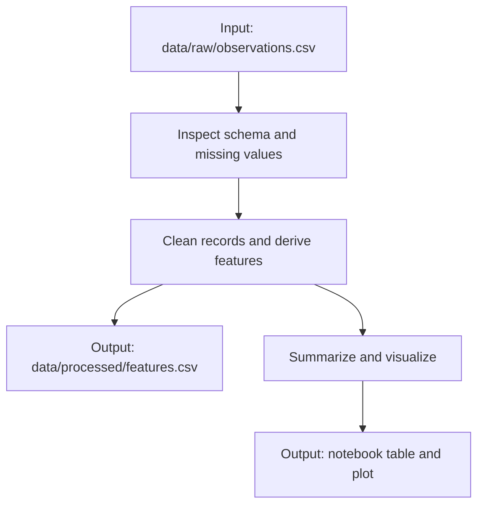

# Notebook conventions

Applies to exploration and demonstrations of analytical behavior. See
[shared rules](core.md) for the approval boundary, [source-code.md](source-code.md)
for promotion, and [pixi.md](pixi.md) for kernel setup.

## Structure and naming

Keep authored notebooks in `notebooks/`. Use `PHASE.NN-initials-description.ipynb`,
such as `0.02-ab-source-inspection.ipynb`. Phases:
0 exploration, 1 cleaning/features, 2 visualization, 3 modeling, 4 publication.
Use the next available number; do not renumber existing work for cosmetic ordering.
When several notebooks cover the same topic, group them in a descriptive subdirectory
such as `notebooks/land-cover/`. Maintain the project notebook index (`notebooks/README.md`)
with relative links, purpose, required inputs, and suggested reading/execution order.
Update links and task paths when moving notebooks; installed package imports work
from nested directories too.

State purpose, inputs, configuration, outputs, and conclusions. Organize chapters
with numbered markdown headings: `3. Buffer Lines` for processing, followed by
`3a. Visualisation - Buffered Lines` when a visualization is useful. Keep processing
and visualization in separate cells/sections; the next processing step is `4.`.
Use this concrete numbering convention consistently. Do not add an empty visualization
section or repeat a map for a step that barely changes the dataset.
Accompany each code cell with plain-language markdown.
Keep code small, direct, and in execution order, using blank lines/comments to separate
logical steps. Avoid repetitive commentary that simply translates each Python line.

Use a visible settings cell for AOI, dates, CRS, thresholds, seeds, and output paths
as applicable. Import paths from `project_package.config`, so code
works from the notebook directory without changing cwd or sys.path. Do not put
installation commands in cells or rely on hidden state.

When adjustable parameters or hyperparameters exist, add a short Markdown table
next to the settings cell with columns `Parameter | Default | Unit | Meaning / why
this default`. Give one sentence per parameter; use dimensionless or n/a when
appropriate. Explain thresholds, model settings, and defaults that affect the result.
Keep the table synchronized with the settings rather than inventing tuning knobs.

## Required visual summary: Mermaid diagram

Always include a visual summary in every notebook you create or update. Place it
in a Markdown cell near the beginning, after the purpose statement, using a fenced
`mermaid` block. The diagram must show at least:

- **Inputs:** source datasets, files, or in-memory data, plus important configuration
  where it affects the workflow.
- **Processing steps:** the main operations in execution order, with arrows showing
  data flow and branches or joins where relevant.
- **Outputs:** resulting datasets, files, figures, maps, or in-notebook summaries.
  Include output paths when known; if nothing is saved, label the in-notebook results.

Keep the diagram concise and specific to the actual notebook. Update it whenever
the workflow changes; do not depict planned or unexecuted steps as completed results.
The diagram complements the written explanation and does not replace execution or
validation evidence.

Example Markdown cell (adapt the labels and paths to the notebook):

````markdown

````

Check that the diagram renders in the intended notebook viewer when feasible. If
Mermaid rendering is unavailable, retain the Mermaid source and state the limitation;
provide a rendered image alongside it when practical rather than silently omitting
the visual summary.

## Execute and inspect

Use representative inputs and a few meaningful tables, plots, or summaries. Inspect
unfamiliar input contracts only as needed; trust known project-created datasets
instead of repeating schema, units, coverage, and missingness audits. A separate
dataset-inspection notebook is useful when it keeps distinct sources understandable;
do not generate notebooks merely to satisfy a count.

Use [geospatial.md](geospatial.md) for spatial checkpoints and
[validation.md](validation.md) to choose consequential checks. Demonstration cells
that were written but not executed do not establish success. If input access or
execution is blocked, explain what remains unverified.

Confirm restart-and-run-all works. Keep small, reviewed outputs that help the user
understand results; remove secrets, large widget payloads, and noisy output before
handoff. Save large products to ignored data/run locations. An executed copy in
`runs/notebooks/` is a generated artifact, not a second editable source notebook.

For new analytical behavior, present the executed demonstration for confirmation
before package promotion. After approval, replace duplicate implementation with
package imports and rerun the same checks. Keep one-off analysis in the notebook.
Avoid concurrent edits to a single notebook and unnecessary metadata churn.

Examples use `project_package` and initials `ab` as placeholders. Use the actual
package, initials, and notebook paths recorded in the project AGENTS.md/README.
