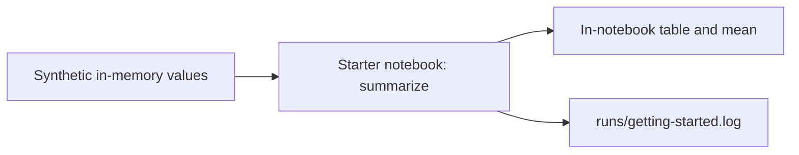

# {{ cookiecutter.project_name }}

{{ cookiecutter.description }}

Author: {{ cookiecutter.author_name }}. Generated from personal data science template
**{{ cookiecutter.__template_version }}**, inspired by Cookiecutter Data Science.

## Setup and commands

Install [Pixi](https://pixi.prefix.dev/), then run from this project directory:

```text
pixi install
pixi run notebook
```

The first install resolves dependencies, creates `pixi.lock`, and installs
`{{ cookiecutter.package_name }}` editable from `src/`. Keep the lockfile for the user
to commit. Subsequent reproduction uses `pixi install --locked` and
`pixi run --locked notebook`. Record the installed `pixi --version` below.

Open `notebooks/0.01-{{ cookiecutter.author_initials }}-getting-started.ipynb` and run all
cells. For a noninteractive execution of that same setup demonstration:

```text
pixi run --locked check-notebook
```

Its executed copy is written to `runs/notebooks/`. Keep authored notebooks in `notebooks/`;
the executed copy is a generated verification artifact. No analysis pipeline exists yet.

Run the included pytest examples with `pixi run --locked test`. Read
[testing guidance](guides/testing.md) before adding tests and
[run reporting](guides/run-reporting.md) before recording substantial runs.

## Project context — fill in as decisions become known

- Question and intended deliverable: TBD
- Input sources, access/download instructions, licenses: TBD
- Area/date range, principal analytical CRS and rationale (spatial work only): TBD
- Processing stages and canonical output paths: TBD
- Key assumptions and decisions: TBD
- Current work / next step / unresolved blockers: inspect the starter notebook
- Pixi version used: TBD

## Pipeline overview

Replace this starter diagram with the actual analysis as it develops.



| Input | Processing / entry point | Output |
| --- | --- | --- |
| Synthetic values 1, 2, 3 | [Getting started](notebooks/0.01-{{ cookiecutter.author_initials }}-getting-started.ipynb) | Table and mean in notebook; `runs/getting-started.log` |
| Authored starter notebook | `pixi run --locked check-notebook` | Executed copy in `runs/notebooks/` |

Use [the notebook index](notebooks/README.md) for purpose, prerequisites, and reading
order. Infrastructure modules: [paths](src/{{ cookiecutter.package_name }}/config.py)
and [run logging](src/{{ cookiecutter.package_name }}/run_logging.py). Add links to
analytical modules and real inputs/outputs as they are implemented.

## Layout

`data/raw/` and `data/external/` hold unchanged sources; `data/interim/` holds useful
checkpoints; `data/processed/` holds canonical results. Add source notes alongside
inputs. Data are ignored by Git, so document retrieval or authorized storage access.

`notebooks/` contains exploration and demonstrations. `src/{{ cookiecutter.package_name }}/`
contains installed reusable code: project paths, explicit output directory creation,
and a standard-library `log_run()` context manager. `guides/` contains
task-specific working instructions, routed by [AGENTS.md](AGENTS.md).

```text
tests/
  unit/                 # Small behavior/regression tests, including logging examples
  integration/          # Connected-stage tests when needed
  fixtures/             # Tiny non-sensitive test inputs
reports/                # Authored LaTeX sources, bibliography, and writing assets
runs/
  figures/              # Generated plots/maps
  tables/               # Summary tables
  notebooks/            # Generated notebook copies/exports
  *.log                 # Useful logs; optional run notes or per-run subdirectories
references/
  data_dictionaries/    # Schemas, field/band meanings, units
  sources/              # Source and methodological references
qgis/
  *.qlr                 # Styled vector/raster definitions referencing ../data/
  projects/             # Inspection projects using relative data paths
```

Generated run artifacts are ignored by Git; authored reports, references and QGIS assets are versioned
after checking size, licensing, and sensitivity. PyQGIS remains optional.
Add `models/` or `configs/` when needed.
Agents leave changes uncommitted for review. Update this README with real commands
and decisions as the project develops; avoid separate competing status documents.

## Shared guides

At task start, follow the hosted-first instructions in [AGENTS.md](AGENTS.md): read
shared working rules and relevant topic guides from GitHub, using the local `guides/`
backup when the URL is unconfigured or the hosted guides cannot be read. Report when
using the backup; it reflects the template used to generate this project.

Hosted guide directory: {{ cookiecutter.guides_url }}not configured yet.

To change the guide source, update its directory URL in AGENTS.md and here.
Reading remote guidance does not update local files. Keep
project-specific rules in AGENTS.md; user instructions and local overrides take
precedence over shared guides.
